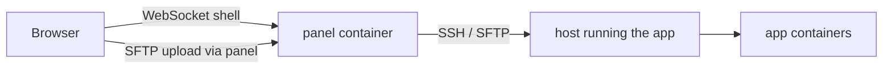

# Launchpad

Self-hosted deploy panel for a Proxmox VM running Docker. Fill in a form, Launchpad pulls or builds an image, starts a container on the shared `web` network, waits for its health check, and Traefik publishes it at `<subdomain>.<BASE_DOMAIN>` through a Cloudflare Tunnel.

Compose projects are first-class: paste or scan a `docker-compose.yml`, review the detected services, assign one or more subdomains per service, and deploy the whole stack. SSH is optional and only used when a project runs on a separate host.

```
Internet ── HTTPS ──> Cloudflare (wildcard DNS + Access)
                            │
                            ▼ Cloudflare Tunnel
                    cloudflared (container)
                            │ http://traefik:80
                            ▼
                       traefik (container)
                        │   Docker labels
          ┌─────────────┴──────────────┐
          ▼                            ▼
   launchpad panel              app containers
   panel.example.com            blog.example.com, api.example.com, …
```

## ⚠️ Security warning — read first

The panel mounts `/var/run/docker.sock`, which is equivalent to **root on the VM**. Anyone who can use the panel can start privileged containers, mount host paths and read every secret the VM can see.

- **Cloudflare Access in front of `panel.<BASE_DOMAIN>` is mandatory.** Do not expose port 3000 publicly.
- Treat the panel admin password, `ENCRYPTION_KEY`, Docker socket and web SSH terminal with the same care as root SSH access.
- The web terminal opens an SSH session from the panel container to your VM's sshd. It is protected by the panel session and Cloudflare Access, but it is still a shell on the host.

## Repository layout

```
apps/server        Express 5 API, Better Auth, Docker orchestration, SQLite/Drizzle
apps/web           React + Vite dashboard and xterm.js SSH terminal
packages/shared    Zod schemas, shared types, Traefik label builder, deployment state machine
Dockerfile         Single production image (API + built React app)
docker-compose.yml cloudflared + Traefik + launchpad on the external `web` network
docker-compose.deploy.yml  VM override: GHCR image + Watchtower self-updates
.github/workflows  CI (typecheck, tests) and Deploy (build, smoke test, GHCR push)
.env.example       Required environment variables
```

## Requirements

- Proxmox VE 8+ with a Debian 12 VM (2 vCPU / 2 GB RAM is enough for the panel; app builds need more).
- A domain managed by Cloudflare.
- A Cloudflare Tunnel token.
- Docker Engine + Compose plugin on the VM.

---

## 1. Create the Proxmox VM and install Docker

Create a Debian 12 VM (or use a Proxmox Debian LXC/VM template) with a static LAN IP or DHCP reservation. SSH into it and install Docker:

```bash
sudo apt update
sudo apt install -y ca-certificates curl git
sudo install -m 0755 -d /etc/apt/keyrings
sudo curl -fsSL https://download.docker.com/linux/debian/gpg -o /etc/apt/keyrings/docker.asc
sudo chmod a+r /etc/apt/keyrings/docker.asc
echo "deb [arch=$(dpkg --print-architecture) signed-by=/etc/apt/keyrings/docker.asc] \
  https://download.docker.com/linux/debian $(. /etc/os-release && echo "$VERSION_CODENAME") stable" \
  | sudo tee /etc/apt/sources.list.d/docker.list >/dev/null
sudo apt update
sudo apt install -y docker-ce docker-ce-cli containerd.io docker-buildx-plugin docker-compose-plugin
sudo usermod -aG docker "$USER"
```

Log out and back in, then create the shared network once:

```bash
docker network create web
```

If you use the web SSH terminal, make sure `sshd` is enabled and reachable:

```bash
sudo systemctl enable --now ssh
```

## 2. Move the domain to Cloudflare

Add the domain in the Cloudflare dashboard and change the registrar's nameservers to the two Cloudflare nameservers. Wait for the zone to become **Active**.

Keep the DNS records you need (for example the Proxmox host record) and delete conflicting `A`/`AAAA` records for the wildcard once the tunnel is set up.

## 3. Create the Cloudflare Tunnel

1. Cloudflare Zero Trust → **Networks → Tunnels → Create a tunnel**. Choose **Cloudflared**, name it `launchpad`, and copy the token.
2. Add a **Public Hostname**:
   - Subdomain: `*`
   - Domain: `example.com`
   - Path: *(empty)*
   - Service: **HTTP** → `traefik:80`
3. Cloudflare creates the DNS records. If you add them manually, the wildcard must be a proxied `CNAME` named `*` pointing at `<tunnel-id>.cfargotunnel.com`.
4. Put the token in `.env` as `TUNNEL_TOKEN`.

The wildcard hostname is what makes every new app subdomain work. Launchpad never calls the Cloudflare API for app DNS: Traefik labels on each app container are enough.

There is no tunnel setting inside Launchpad's dashboard. The connector is the `cloudflared` service in `docker-compose.yml`, and it reads `TUNNEL_TOKEN` from `.env`. After `docker compose up -d`, `docker compose logs -f cloudflared` should show `Registered tunnel connection`. To rotate the token, update `.env` and run `docker compose up -d --force-recreate cloudflared`.

## 4. Create the Cloudflare Access application for the panel

1. Zero Trust → **Access → Applications → Add an application → Self-hosted**.
2. Application domain: `panel.example.com` (exactly the hostname in `BETTER_AUTH_URL`).
3. Add a policy that allows only your email (one-time PIN or your identity provider). Keep the default **Deny** for everyone else.
4. Optionally set a short session duration.

For the CI/CD webhook, either create a **service token** or bypass only the hook path:

**Option A — service token (recommended)**

1. Zero Trust → Access → **Service Auth → Service Tokens → Create Service Token**. Copy the Client ID and Client Secret (shown once).
2. Open the Access application for `panel.example.com` → Policies → add a policy with action **Service Auth** and include that service token.
3. Add `CF_ACCESS_CLIENT_ID` and `CF_ACCESS_CLIENT_SECRET` as GitHub repository secrets (see step 7). The generated workflow sends them as headers.

**Option B — bypass the hook path**

1. Zero Trust → Access → Applications → Add a self-hosted application for `panel.example.com` with path `api/hooks` (or `/api/hooks/*`).
2. Add a policy with action **Bypass** for Everyone.
3. GitHub Actions then does not need the two CF headers. The generated workflow still sends them; either add dummy values or remove those two `-H` lines. The per-app webhook secret/HMAC remains the only protection on that path.

## 5. Start the stack

On the VM, clone/copy this repository, then:

```bash
cp .env.example .env
```

Generate the secrets:

```bash
openssl rand -base64 32   # BETTER_AUTH_SECRET
openssl rand -base64 32   # ENCRYPTION_KEY
```

Edit `.env`:

```dotenv
BASE_DOMAIN=example.com
ADMIN_EMAIL=you@example.com
ADMIN_PASSWORD=a-long-password
BETTER_AUTH_SECRET=<generated>
BETTER_AUTH_URL=https://panel.example.com
ENCRYPTION_KEY=<generated>
TUNNEL_TOKEN=<from the Cloudflare tunnel>
```

`BETTER_AUTH_URL` must be exactly the public panel origin (including `https://`). Better Auth rejects other origins.

Start the stack:

```bash
docker compose up -d --build
docker compose logs -f launchpad
```

On first start the server runs migrations, creates the single admin user from `ADMIN_EMAIL` / `ADMIN_PASSWORD` if the user table is empty, and starts listening. Sign-up is disabled in Better Auth; the admin is inserted with the same password hasher Better Auth uses for login.

Open `https://panel.example.com`. Cloudflare Access prompts first, then the panel login.

> Changing `ADMIN_EMAIL` / `ADMIN_PASSWORD` later does not modify an existing user. Use **Settings → Change password** instead.

## 6. Deploy a first test app

1. Click **New app**.
2. Name: `demo`, subdomain: `demo`, source: **Docker image**, image `nginx:1.27-alpine`, internal port `80`, health path `/`.
3. Submit. You are redirected to the app page and the deployment log streams live:

```
Pulling image nginx:1.27-alpine
Container ... started; waiting for health.
Health check passed: HTTP 200 ...
Deployment healthy. Traffic is now routed to the new container.
```

4. Open `https://demo.example.com`. The wildcard DNS record and Traefik labels make it live immediately.
5. Use the **Terminal** button on the app page for a shell on the host that runs the app and to upload files onto it (see [Per-app host terminal](#per-app-host-terminal-and-file-upload)).

How deployments stay up during a redeploy:

- The new container gets the **same** Traefik router/service labels as the old one. Traefik merges the containers into one service with two healthy servers.
- The service has an active health check (the app's health path, every 5 s). Traffic only moves to the new container after it answers.
- Launchpad removes the old container after the new one is healthy. If the new container never becomes healthy, it is removed and the old one keeps serving.

## 6b. Deploy a compose project

1. Click **New app** and choose **Compose project**.
2. Paste a compose file, or point Launchpad at a repository, branch and compose path.
Each project can override the panel domain in its configuration. Leave it empty to use the global base domain, set a real hostname such as `petrik.hu`, or set it to `localhost` for local tests. `localhost` projects use `http://<service>.localhost` host rules; browsers resolve `*.localhost` to loopback, but a local Traefik on the `web` network is still required to serve them. Subdomain uniqueness is scoped to the effective domain, so two projects can both use `api` on different domains.

For localhost tests, run a local Traefik once (re-run it after a Docker restart):

```bash
docker run -d --name traefik-local --network web -p 80:80 \
  -v /var/run/docker.sock:/var/run/docker.sock:ro \
  traefik:v3 \
  --providers.docker=true \
  --providers.docker.exposedbydefault=false \
  --providers.docker.network=web \
  --entrypoints.web.address=:80
```

Then open `http://<service>.localhost`. If port 80 is taken, publish `8080:80` and use `http://<service>.localhost:8080`. Update the project env and build args (`BETTER_AUTH_URL`, `CORS_ORIGINS`, admin `VITE_API_URL`/`VITE_WEB_URL`, web `PUBLIC_SITE_URL`) to the localhost hostnames.

The compose source can be inline YAML or a GitHub repository (branch + compose path). Repository-sourced projects are re-read from the branch on every deployment and support a GitHub push webhook: a push to the configured branch queues a new deployment. CI/CD with GitHub Actions remains available for single-container Dockerfile builds; compose stacks use the push webhook instead.

3. Click **Scan compose**. Launchpad parses the YAML and asks you to confirm:
   - which services are published through Traefik,
   - one or more subdomains per published service,
   - the container port and health path per service,
   - literal environment values and any `${VAR}` placeholders.
4. Choose a **deployment target**:
   - **This host** (default) uses the panel's Docker socket. No SSH is needed.
   - **Separate host** runs the stack over SSH using **Settings → Remote hosts**.
5. Submit. Launchpad renders a deploy file that:
   - adds Traefik labels to published services (one router per service, all hostnames in one rule),
   - attaches them to the external `web` network,
   - removes published host ports from every service, so several projects can use the same internal ports,
   - prefixes named volumes so their data survives redeploys,
   - keeps every other compose feature (`depends_on`, commands, bind mounts, extra networks).

Compose stacks use a stable `launchpad-<app>` project name. The previous project is stopped before the new configuration starts because two containers cannot share a Postgres data volume at once; if the new stack fails, the previous project is started again. Compose services that are not published still run for dependencies.

Databases and queues (Postgres, MySQL, Redis, MongoDB, RabbitMQ, Kafka, …) are detected from the service name, image and healthcheck and are **not published by default**; publishing them would make Traefik probe an HTTP health path that does not exist. Set the health path explicitly for HTTP services, e.g. `/health` or `/api/health`. On a failed deploy the panel now appends the containers' logs before removing the failed stack.

> Remote targets cannot build images on the remote host; use prebuilt images for those services. Traefik routing on a remote host requires Traefik (and the `web` network) to be present there.

If a GitHub repository you are adding contains a compose file, use the **Use docker-compose** shortcut on the GitHub source tab: it switches to the compose flow with the repository and branch prefilled and scans the repo.

## 7. Set up CI/CD with GitHub Actions

Prerequisites: a GitHub source app and a GitHub token stored in **Settings → GitHub** (classic PAT with `repo` scope; needed to commit the workflow file).

1. In the app page, enable **CI/CD with GitHub Actions**.
2. The CI/CD panel shows:
   - the webhook URL (`https://panel.example.com/api/hooks/deploy/<app-id>`),
   - the per-app webhook secret,
   - the exact GitHub repository secret names,
   - the generated workflow YAML (copy it or commit it with one click).
3. If you have not created the Access service token yet, go back to step 4 and add `LAUNCHPAD_WEBHOOK_SECRET`, `CF_ACCESS_CLIENT_ID`, `CF_ACCESS_CLIENT_SECRET` under **GitHub → Settings → Secrets and variables → Actions**.
4. Click **Commit workflow to repo** (or paste the YAML into `.github/workflows/launchpad-deploy.yml` manually).
5. Make the GHCR package pullable by the panel:
   - **Public package:** nothing else to do.
   - **Private package:** store a PAT with `read:packages` under **Settings → GHCR** in Launchpad.
6. Push to the configured branch. The Action:
   - builds with `docker/build-push-action`,
   - pushes `ghcr.io/<owner>/<repo>:<github.sha>` **and** `:latest`,
   - calls the Launchpad webhook with the image tag and commit SHA.
7. Launchpad pulls the image with the GHCR credentials from Settings, starts the container, health-checks it, swaps traffic and removes the old container.

The webhook secret is sent as `X-Launchpad-Secret` and compared in constant time. If the Access service token is not used, create the bypass application from step 4; the webhook secret/HMAC is then the only auth on that path.

### Plain GitHub push webhook (CI/CD off)

For a GitHub-source app with CI/CD **disabled**, Launchpad builds the branch itself. The CI/CD panel shows the push webhook URL.

1. GitHub repo → Settings → Webhooks → Add webhook.
2. Payload URL: `https://panel.example.com/api/hooks/github/<app-id>`.
3. Content type: `application/json`.
4. Secret: the app's webhook secret.
5. Events: **Just the push event**.

Launchpad verifies `X-Hub-Signature-256` (HMAC-SHA256 over the raw body), checks the ref matches the configured branch, and queues a build. The **Redeploy** button does the same build on demand.

## Web SSH terminal (GUI / CLI) and remote projects

SSH is optional. Projects deployed with the **local** target use the Docker socket and never open an SSH connection. The same credentials are used for two things:

- the browser terminal,
- deploying a project whose target is a **separate host**.

1. Ensure `sshd` runs on the VM (for the terminal) and/or on the remote host (for remote projects), and you know a username plus password or an unencrypted private key.
2. In **Settings → Remote hosts & web SSH terminal** set host `host.docker.internal` (compose maps it to the VM gateway) or the VM's LAN IP, the SSH port (usually 22), the username and the auth method.
3. Use the **GUI / CLI** switch in the sidebar (or `Ctrl + \``) to move between the dashboard and the terminal.

The connection originates inside the panel container on the `web` network. The SSH host key is currently accepted without pinning; restrict the panel's network exposure and rely on Cloudflare Access.

### Per-app host terminal and file upload

Every app has one terminal at **App page → Terminal** (running apps also show a shortcut on the dashboard card). It opens an SSH shell on the host that runs the app, using the credentials from **Settings → Remote hosts**: the VM itself for local targets, the configured remote host for remote targets. It is intentionally one terminal per app, not per compose service — from there `docker`, `docker compose` and the app's directories are all reachable.

- Requires `sshd` and SSH credentials. Without them the terminal reports that SSH is not configured; nothing is executed through the Docker socket.
- The shell starts in the app's workspace on the host: `<host data dir>/repos/<app id>`, the same directory the panel uses for that app's repository clone. The host data dir is read from the panel container's `/data` mount; set `HOST_DATA_DIR` if the panel is not running from the compose stack. Files uploaded here are the app's own working files; the SSH user must be able to write them (use the same user that owns `data/`, or root).
- Uploads: the destination defaults to that workspace (default `/tmp` when the workspace is unknown) and can be changed per upload. Files are streamed over SFTP and renamed into place, so an interrupted or over-limit upload never truncates an existing file. The per-file limit lives in **Settings → Host uploads** (default 64 MB, max 4096 MB).
- Compose stacks: inspect a single service from the same shell with `docker compose -p launchpad-<id> exec <service> sh`; there is deliberately no service picker.

> The SSH host must be reachable **from the panel container**. `host.docker.internal` only maps to the VM that runs the panel, so an app on a different network needs a path there: a WireGuard/Tailscale mesh, a jump host, or a tunnel (e.g. Cloudflare Access SSH). There is one SSH endpoint in Settings shared by every app terminal and upload; per-app endpoints are not implemented.



## CI/CD for Launchpad itself

`.github/workflows/ci.yml` runs typecheck and tests on every push and pull request. `.github/workflows/deploy.yml` runs on `main`: it builds the Docker image, boots it once and waits for `/healthz`, and only then pushes `ghcr.io/kozsombat/launchpad:<sha>` and `:latest`. An image that fails the smoke test never reaches the VM.

The VM pulls releases itself with Watchtower, so nothing has to be exposed to the internet and no deploy SSH key is needed:

1. On the VM, in the repository checkout, pick up the new compose files: `git pull`.
2. Make the package pullable:
   - **Public package:** GitHub → your profile → Packages → `launchpad` → Package settings → Change visibility → Public.
   - **Private package:** run `docker login ghcr.io -u KoZsombat` once on the VM with a PAT that has `read:packages`, then uncomment the `/root/.docker/config.json:/config.json` mount in `docker-compose.deploy.yml`.
3. Start the deploy stack once so the panel runs the published image instead of a local build:

```bash
docker compose -f docker-compose.yml -f docker-compose.deploy.yml pull launchpad
docker compose -f docker-compose.yml -f docker-compose.deploy.yml up -d --no-build
```

From then on, every push to `main` is built, smoke-tested, pushed, and picked up by Watchtower within about a minute (`WATCHTOWER_POLL_INTERVAL`). `.env` and `data/` are untouched by updates. Watchtower has no rollback: if a release is bad after the smoke test, revert the commit or re-tag a known-good image.

## Local development

### Local Mac testing (Docker Desktop)

Running `pnpm dev` on macOS cannot pass compose/container health checks: the panel process on the host cannot reach Docker Desktop container IPs on the `web` network. Run the panel as a container on `web` instead:

```bash
docker build -t launchpad:local .
docker network create web 2>/dev/null || true
mkdir -p data-local

docker run -d --name launchpad-local --network web -p 3000:3000 \
  -v /var/run/docker.sock:/var/run/docker.sock \
  -v "$PWD/data-local:/data" \
  -e NODE_ENV=development -e PORT=3000 \
  -e BASE_DOMAIN=example.com \
  -e ADMIN_EMAIL=admin@example.com -e ADMIN_PASSWORD=password123 \
  -e BETTER_AUTH_SECRET=local-dev-secret-at-least-32-characters \
  -e BETTER_AUTH_URL=http://localhost:3000 \
  -e ENCRYPTION_KEY=local-dev-encryption-key-32-chars \
  -e DATABASE_PATH=/data/launchpad.db -e DATA_DIR=/data \
  -e WEB_DIST=/app/public -e COOKIE_SECURE=false \
  launchpad:local
```

Open `http://localhost:3000`. `data-local/` is ignored by Git and Docker. For `localhost` project domains, run the local Traefik command in the compose section above. This path is for local testing only; use the full Compose stack and Cloudflare tunnel for the real deployment.

### Host development

```bash
corepack enable            # or install pnpm 12 yourself
pnpm install
docker network create web  # only if you want to deploy from your laptop
cp .env.example .env       # set BETTER_AUTH_URL=http://localhost:3000, COOKIE_SECURE=false
pnpm dev                   # API on :3000, Vite on :5173 with /api proxy
```

Host deployment works for UI development, but use the containerized panel above when testing compose health checks on macOS.

`.env` for local development:

```dotenv
BASE_DOMAIN=example.com
ADMIN_EMAIL=admin@example.com
ADMIN_PASSWORD=password123
BETTER_AUTH_SECRET=0123456789abcdef0123456789abcdef
BETTER_AUTH_URL=http://localhost:3000
ENCRYPTION_KEY=0123456789abcdef0123456789abcdef
COOKIE_SECURE=false
TUNNEL_TOKEN=unused
```

The API stores its SQLite file and cloned repositories under `apps/server/data/` in development.

### Migrations

Schema changes are made in `apps/server/src/db/schema.ts`, then:

```bash
pnpm db:generate
```

Commit the generated `apps/server/drizzle/` SQL and metadata. The server runs `migrate()` on startup.

### Tests

```bash
pnpm test
pnpm typecheck
pnpm build
```

Tests cover shared Zod validation, subdomain/reserved-name rules, multi-subdomain Traefik label generation, compose scanning/generation, the deployment state machine and GitHub webhook HMAC verification.

## Operations notes

- **Data**: `./data/launchpad.db` (SQLite), `./data/repos/<app-id>` (cloned branches). Back up this directory.
- **Secrets at rest**: env values, registry credentials, GitHub/GHCR tokens, the webhook secret and the SSH password/key are encrypted with AES-256-GCM using `ENCRYPTION_KEY`. Changing that key makes existing secrets unreadable.
- **Base domain changes** only affect future deployments; redeploy an app to rewrite its Traefik `Host()` rule.
- **App names and subdomains** are unique per effective domain. Delete and recreate to rename. Compose service subdomains are validated against every project's hostnames on that domain.
- **Volumes**: a volume is created on first deploy. Single-container volumes use their configured names; compose named volumes are stored as `launchpad-<project>-<name>` so they survive redeploys. Deleting an app can optionally remove its named volumes.
- **Compose projects** use a stable `launchpad-<app>` project name. The previous project is stopped before the new one starts (required for shared database volumes) and restarted if the new deployment fails.
- **Logs**: deployment logs are stored with the deployment. Container logs are streamed live via SSE and are not persisted.
- **Single user**: Better Auth email/password with sign-up disabled. Login is rate-limited to 10 attempts per 15 minutes per IP.

## Troubleshooting

| Symptom | Check |
| --- | --- |
| `404` from Traefik for a new subdomain | Container is running, has `traefik.enable=true`, is on the `web` network, and the wildcard DNS record is proxied. |
| `502` / `504` for an app | Internal port is wrong, or the app is not listening on `0.0.0.0`. Check the container log panel. |
| Deployment fails at “waiting for health” | Health path must return 2xx/3xx on the app's internal port. The panel must be on the `web` network to reach the container IP. Raise `HEALTH_TIMEOUT_MS` for slow starters. |
| GitHub build fails | The panel image includes `git`/`openssh-client`; private repos need a token. Dockerfile and build context must resolve inside the repository. |
| GHCR pull `unauthorized` | Add a `read:packages` token under Settings → GHCR, or make the package public. |
| Better Auth “Invalid origin” | `BETTER_AUTH_URL` must exactly match the browser origin, e.g. `https://panel.example.com`. |
| Webhook returns `401` | Wrong per-app secret, or Cloudflare Access blocked the request before it reached the panel. |
| SSH terminal says “not configured” | Fill in Settings → Remote hosts & web SSH terminal, and verify the panel container can reach the VM's sshd. |
| Remote compose project fails immediately | SSH credentials are missing, or the remote Docker CLI/compose plugin is absent. Remote projects cannot build images. |
| Compose project from a GitHub repo does not redeploy on push | The repository webhook secret must match the project's webhook secret, and the push must target the configured branch. Compose projects use the push webhook, not the Actions workflow. |
| Compose service is not reachable | The service must be published, have a subdomain, listen on the configured container port, and (remote targets) be behind a Traefik instance on that host. |
| Compose deploy fails on missing variables | Fill every required `${VAR}` under the project's compose variables or per-service environment overrides. |
| SSE log stream stalls behind a proxy | Responses set `X-Accel-Buffering: no`; ensure no additional buffering proxy is in front of Traefik. |

## License

[GNU Affero General Public License v3.0](LICENSE) (`AGPL-3.0-only`), plus the attribution term in [NOTICE](NOTICE). Copyright (C) 2026 KoZsombat.

What that means in practice:

- **Use it however you like**, including commercially. Self-hosting, modifying and redistributing are allowed.
- **Distributing it or a modified version?** Pass on the source under AGPL and keep the notices; state what you changed.
- **Running a modified version for users over a network?** Those users must be offered the corresponding source (AGPL §13).
- **Credit:** whenever you distribute or publish this program, or a work containing it — modified or not — keep `Based on Launchpad by KoZsombat — https://github.com/KoZsombat/Launchpad` in its visible legal notices (About page, footer, or equivalent). This is an additional term explicitly permitted by AGPL §7, so the project remains recognized as AGPL-3.0.
- **No warranty.**

Two honest limits: a private, unmodified self-host is not "conveying", so AGPL does not force an in-app credit for it (only a custom license could); and no trademark rights are granted, so forks must not imply endorsement.

MIT and Apache-2.0 are the usual alternatives if you ever prefer permissive terms over copyleft.
